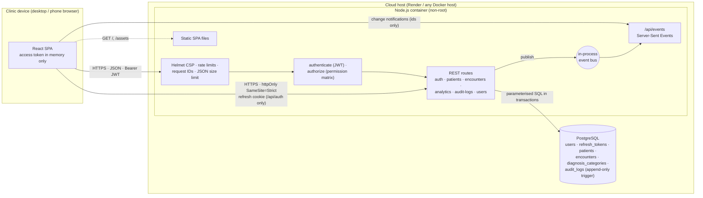
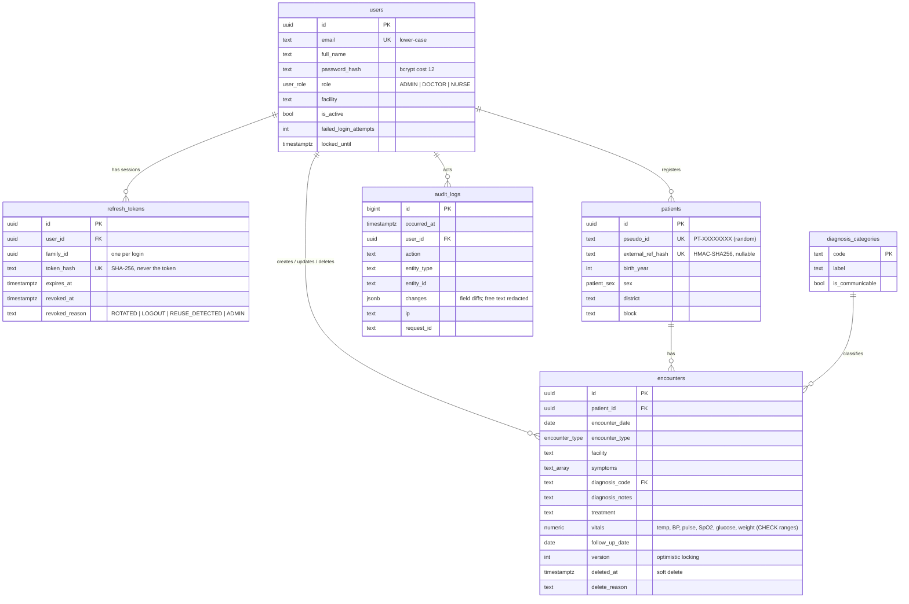
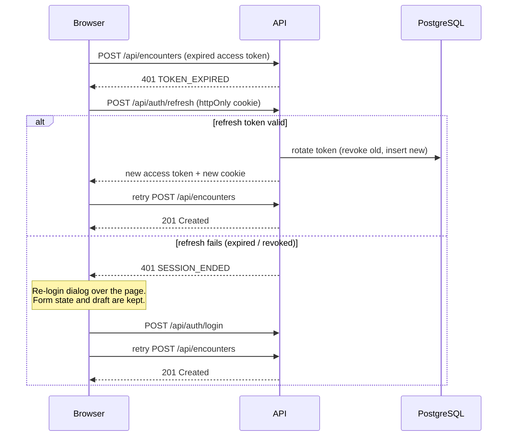

# Architecture & Security

## 1. System overview

**Request flow for saving an encounter:**

1. The React form validates input locally for instant feedback.
2. `POST /api/encounters` is sent with `Authorization: Bearer <access token>`.
3. Helmet headers, rate limiting and a 100 KB body limit apply.
4. `authenticate` verifies the JWT signature, issuer and audience, then loads the user from the database. Role and active status always come from the database, never from the token.
5. `authorize('encounter:create')` checks the permission matrix. A denial is written to the audit log.
6. The Zod schema validates the body (strict, so unknown fields are rejected) and applies cross-field clinical rules.
7. In **one transaction**, the encounter row and its audit row are inserted together. Either both are saved or neither is.
8. An `encounter.created` event (id only) goes onto the bus, and SSE pushes it to every connected client. Dashboards and lists then refetch through the normal access-controlled API.

## 2. Technology choices

| Layer | Choice | Why |
|---|---|---|
| Frontend | **React 19 + Vite**, Tailwind CSS v4, Recharts | Widely known and quick to build with. Tailwind gives a consistent, responsive design system with light and dark tokens. Recharts produces accessible SVG charts with tooltips. The dashboard bundle is lazy-loaded, so nurses on slow rural connections never download the charting library. |
| API | **Node.js + Express 5** | Express 5 forwards errors from async handlers, so there are no unhandled promise rejections. It has a mature security middleware ecosystem (Helmet, express-rate-limit). |
| Validation | **Zod** | One schema both parses and validates. Handlers read only `req.valid.*`, so unvalidated input never reaches SQL. `.strict()` rejects unexpected fields such as an accidental `patientName`. |
| Database | **PostgreSQL** | Relational integrity (foreign keys, CHECK constraints as a second line of defence for vitals ranges), transactions for audit atomicity, `date_trunc` and `generate_series` for time-series analytics, and triggers for the immutable audit log. |
| Data access | **`pg` with hand-written parameterised SQL** | Analytics needs real SQL anyway, and every query is visible for security review. All values are bound parameters. The only interpolated pieces (sort column, column lists) come from fixed allow-lists. |
| Real-time | **Server-Sent Events** | One-way server-to-client notifications are all that's needed. SSE works over plain HTTP through proxies, needs no extra infrastructure, and reconnects simply. |
| Packaging | **Docker (multi-stage)**, Render Blueprint | One image serves the API and SPA, runs as a non-root user and has a healthcheck. The free tier is enough for the demo. |
| Testing | **Vitest + Supertest** against real PostgreSQL | Tests exercise the real SQL, constraints and triggers, not mocks. |

## 3. Data model

**Anonymisation design.** The system stores the minimum needed for care continuity and public-health analytics:

- **Age** is stored as birth year, and analytics uses age bands only.
- **Location** is district and block. No village or address is kept.
- **Identity** is a random pseudo ID printed on the patient's card.

When a clinician enters an ABHA, Aadhaar or phone number, it is normalised and stored as `HMAC-SHA256(PSEUDONYM_SECRET, value)`. That catches "this patient is already registered" without the number being recoverable. A plain SHA-256 of a 10-digit phone number could be brute-forced in seconds, and the keyed HMAC prevents that. `PSEUDONYM_SECRET` is deliberately separate from `JWT_SECRET`.

## 4. Security controls

The controls below are listed against what they defend against.

| Threat | Control | Where |
|---|---|---|
| Credential stuffing / brute force | Per-IP login rate limit (20 per 15 min). Account lockout after 5 failures for 15 min, with an atomic SQL increment so parallel guesses can't race past the limit. bcrypt cost 12. | `routes/auth.js` |
| Account enumeration | Identical error for unknown email and wrong password. A dummy bcrypt compare equalises response time. | `routes/auth.js` |
| Token theft via XSS | Access token held **in memory only** (never localStorage). Refresh token is in an `httpOnly` cookie, so JavaScript can't read it. Strict CSP: `script-src 'self'`, no inline scripts, `object-src 'none'`. | `api/client.js`, `app.js` |
| CSRF | Refresh cookie is `SameSite=Strict` and scoped to `Path=/api/auth`. Every other endpoint needs a Bearer header, which browsers never attach automatically. | `routes/auth.js` |
| Stolen refresh token | Tokens rotate on every refresh and are stored as SHA-256 hashes. **Reuse detection**: presenting an already-rotated token revokes the whole token family and writes `REFRESH_TOKEN_REUSE` to the audit log. A 15-second grace window keeps two tabs refreshing at once from tripping it. | `routes/auth.js` |
| JWT forgery | HS256 pinned (blocks `alg:none` and algorithm confusion); issuer and audience verified; 15-minute lifetime. | `lib/tokens.js` |
| Stale privileges | Role and `is_active` are read from the database on every request. Deactivating a user, changing their role or resetting their password also revokes their refresh tokens. The SSE stream closes when the token expires. | `middleware/auth.js`, `routes/users.js`, `routes/events.js` |
| Broken access control | A central permission matrix, checked server-side on every route. Row-level rule: nurses can read only rows they created. Admins have no encounter or patient access. Every denial is audited. | `lib/permissions.js`, `routes/encounters.js` |
| Injection | Zod validation and parameterised SQL only; allow-listed sort columns. React escapes all rendered text. | all routes |
| Lost updates / tampering | Optimistic locking (`version`) returns 409 with the latest copy, and the UI shows which fields conflict. Soft delete requires a reason. | `routes/encounters.js` |
| Repudiation / insider misuse | Append-only `audit_logs`: a DB trigger rejects UPDATE and DELETE. Audit rows are written **in the same transaction** as the change. Each row records user, role, IP, user agent and request ID. | `001_init.sql`, `lib/audit.js` |
| Over-exposure in logs | Audit diffs redact free-text clinical fields (`symptoms`, `diagnosis_notes`, `treatment`), so admins reading the audit log don't see clinical narrative. 500 errors return only a request ID. | `lib/audit.js`, `middleware/errors.js` |
| Data in transit / caching | HSTS and `upgrade-insecure-requests` in production; `Cache-Control: no-store` on all API responses; `Referrer-Policy: no-referrer`; `frame-ancestors 'none'`. | `app.js` |
| Abuse / DoS | 300 requests per minute per IP across the API; 100 KB JSON body limit; page size capped at 100; analytics range capped at 3 years. | `app.js`, schemas |
| Shared clinic computers | Unsaved drafts live in `sessionStorage` (this tab only) and are wiped on sign-out. Nothing clinical goes in `localStorage`. | `lib/drafts.js` |
| Supply chain | Small dependency set; `npm audit` runs in CI; the Docker runtime image installs production dependencies only and runs as non-root. | `Dockerfile`, CI |

### Alignment with India's Digital Personal Data Protection Act, 2023

| DPDP principle | How the design supports it |
|---|---|
| Data minimisation (§6) | No names, contacts or addresses. Birth year, coarse location and a pseudo ID only. External IDs are kept only as a keyed hash. |
| Purpose limitation | Only clinical-care and public-health fields are collected. Analytics are aggregate-only for the admin role. |
| Reasonable security safeguards (§8(5)) | Encryption in transit, access control, hashed secrets, immutable audit trail, and the controls listed above. |
| Accountability / breach readiness (§8(6)) | Audit log of access, changes, failed logins and token-reuse events supports investigation and notification. |
| Accuracy (§8(3)) | Validation rules, optimistic locking and an edit history of who changed what. |

**Not yet in place** (see the self-assessment): encryption at rest is left to the managed database provider; there is no consent capture or data-principal rights workflow (access, erasure requests) and no automated retention policy.

## 5. Real-time updates and session handling

Concurrent 401s share one refresh request (a single deduplicated promise), so a burst of parallel API calls can't trigger false token-reuse alarms.

## 6. Scalability path

The current deployment is a single container, which is right for a district pilot (tens of clinicians, thousands of encounters per month). Analytics queries hit indexed columns (`encounter_date`, `(diagnosis_code, encounter_date)`, partial indexes excluding deleted rows). Against the 1,500-encounter seed dataset the full 12-month summary endpoint (8 aggregate queries in parallel) responds in about 12–17 ms on a laptop, once the connection pool is warm.

To scale out:

1. **Several API instances**: replace the in-process event bus with PostgreSQL `LISTEN/NOTIFY` or Redis pub/sub so SSE events reach clients on every instance. Rate-limit counters move to Redis.
2. **Analytics at state scale**: pre-aggregate daily counts into a materialised view (or a TimescaleDB continuous aggregate) refreshed every few minutes, and point dashboards at it.
3. **Reads**: a read replica for analytics; keep writes on the primary.
4. **Offline clinics**: a service worker with an IndexedDB outbox, so encounters entered without connectivity sync later. The optimistic-locking `version` field already supports conflict detection.
5. **Multi-tenant (several NGOs or states)**: add `organisation_id` to every table and enforce it with PostgreSQL row-level security as defence in depth.
